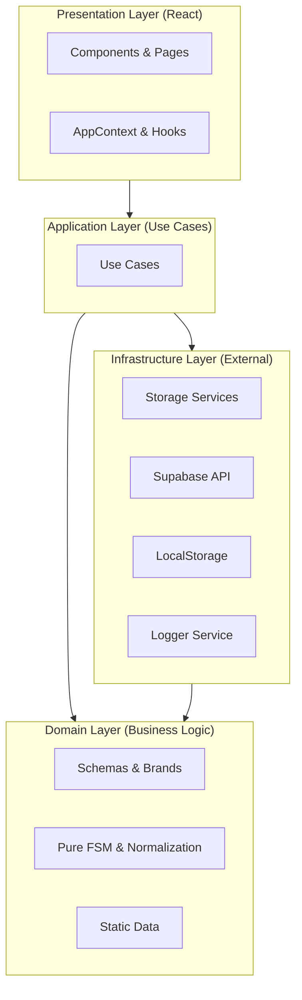

# PTE Class Coverage Tracker

A type-safe React application for tracking PTE exam preparation class coverage and sessions.

Built with layered architecture and Effect Schema validation for safer data handling at application boundaries.

---

## Key Features

- **☁️ Cloud Persistence (Supabase)**: Loads a user's saved state after sign-in and automatically saves subsequent changes. Initialization stops after fatal load failures to avoid overwriting cloud data.
- **👤 Guest Mode**: Offline-first design utilizing `localStorage` if not logged in.
- **📊 Smart Priority & Weightage**: Orders question types dynamically by mark contribution (High to Low) to focus study plans.
- **🔒 Overwrite on Login**: Overwrites local work with cloud-saved profiles upon sign-in for clean state transitions.

---

## Architectural Principles

This codebase enforces strict software safety systems using **Effect-TS**:

- **Runtime Boundary Validation**: Effect Schema validates imported, local, and cloud state before it enters the app.
- **Nominal & Branded Types**: Strongly differentiates distinct database IDs (e.g. `ClassId`, `ModuleId`, `SessionId`) using `@effect/schema` branding to prevent accidental cross-assignment.
- **Strict Boundary Validation**: Evaluates external data at boundaries (network requests, imports, and localStorage) using schemas that reject invalid state before it enters the application.
- **Algebraic Data Errors**: Custom errors inherit from `Data.TaggedError`, facilitating compile-time checks and pattern matching on failure cases.
- **State Immutability**: Application use cases return updated state instead of mutating the existing state in place.
- **Property-Based Testing (`fast-check`)**: Selected normalization and state-merging properties are checked against randomized inputs.

---

## Architecture Diagram

The project uses clean unidirectional flow logic:



---

## Tech Stack

- **Framework**: React 19 + Vite
- **Effect Library**: Effect-TS Schema/Either utilities
- **Backend & Auth**: Supabase
- **Styling**: Vanilla CSS (Premium Aesthetics, Dark Mode support)
- **Testing**: Vitest + React Testing Library + fast-check

---

## Setup & Configuration

### Environment Variables
Create a `.env` file in the root directory:
```env
VITE_SUPABASE_URL=your_supabase_project_url
VITE_SUPABASE_ANON_KEY=your_supabase_anon_key
```

For a fresh database, follow [Database setup](supabase/README.md). The migration creates
`pte_tracker_state` with explicit grants and RLS so authenticated users can read and
upsert only their own state. Guest mode works without Supabase configuration.

### GitHub Actions Deployment
For production builds (e.g. GitHub Pages), configure the secrets in your repository settings:
- `VITE_SUPABASE_URL`
- `VITE_SUPABASE_ANON_KEY`

---

## Scripts

Use the following npm scripts for development and verification:

| Command | Description |
| ------- | ----------- |
| `npm run dev` | Starts the Vite development server |
| `npm run build` | Compiles TypeScript and builds the bundle |
| `npm run lint` | Runs `oxlint` with `--deny-warnings` |
| `npm run format` | Formats all code with Prettier |
| `npm run type-check` | Performs strict TypeScript checks |
| `npm run test` | Runs the test suite |
| `npm run test:architecture` | Verifies clean architecture layers with `dependency-cruiser` |
| `npm run check` | Executes formatting, lint, type-checking, tests, and architecture constraints |
